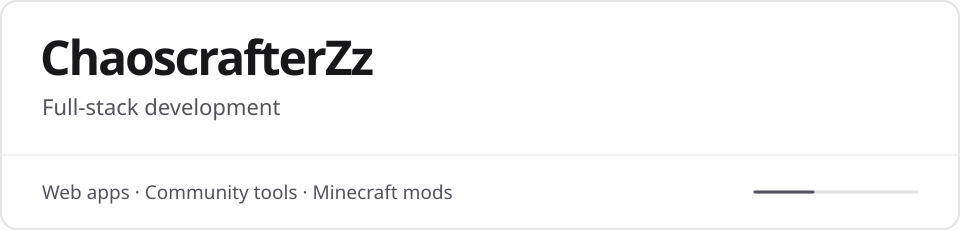

I build web apps, community tools, and Minecraft mods. I work across interfaces, APIs, databases, and the tools that connect them.

## What I build

| Area | Work |
| --- | --- |
| Web apps | Next.js and React interfaces, Express APIs, and database access with Prisma or Drizzle |
| Community tooling | Discord bots and dashboards built with TypeScript |
| Game and desktop tooling | Java-based Minecraft integrations, Kotlin tooling, and Electron apps |

## Tech stack

## GitHub activity

### Top languages

| Language | Share |
| --- | ---: |
| Java | 45% |
| TypeScript | 41% |
| CSS | 5% |
| HTML | 3% |
| JavaScript | 3% |
| Other | 3% |

Based on GitHub language bytes across 11 selected personal and team repositories. Percentages are rounded. The figures describe repository code, including shared work.

### Contribution snake

<picture>
  <source media="(prefers-color-scheme: dark)" srcset="https://raw.githubusercontent.com/ChaoscrafterZz/ChaoscrafterZz/output/snake-dark.svg">
  
</picture>
